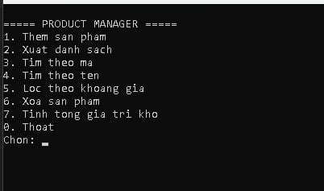
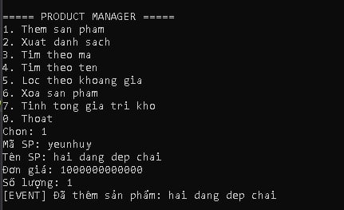
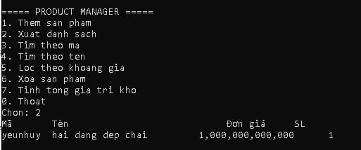
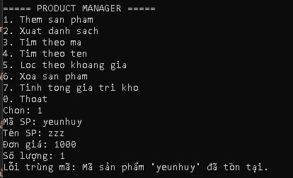
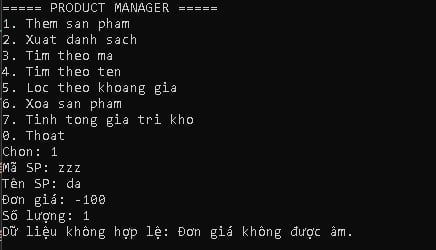
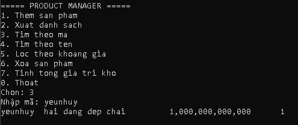
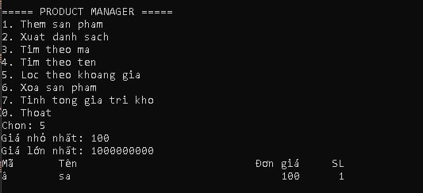
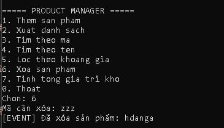
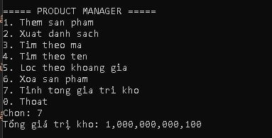

# 2611COMP101904 – Lab 04: Exception, Delegate/Event, Func/Action và Generic

Chương trình **Console C# (.NET 8)** quản lý sản phẩm trong bộ nhớ bằng `Repository<T>`.
Môn **2611COMP101904 – Lập trình trên Windows**, Buổi 4.

- Sinh viên: Nguyễn Hải Đăng
- MSSV: 51.01.104.019
- Lớp: 51.CNTT.A

## Cách chạy

1. Cài .NET 8 SDK (hoặc Visual Studio 2022 trở lên).
2. Mở file `Lab04.csproj` bằng Visual Studio và nhấn **F5**.
3. Hoặc chạy bằng dòng lệnh: `dotnet run` trong thư mục project.

## Cách sử dụng

Chọn số trong menu rồi nhập dữ liệu theo hướng dẫn:

| Lựa chọn | Chức năng |
|---|---|
| 1 | Thêm sản phẩm (mã, tên, đơn giá, số lượng) |
| 2 | Xuất danh sách |
| 3 | Tìm theo mã |
| 4 | Tìm theo tên (chứa từ khóa, không phân biệt hoa/thường) |
| 5 | Lọc theo khoảng giá |
| 6 | Xóa sản phẩm |
| 7 | Tính tổng giá trị kho |
| 0 | Thoát |

## Chức năng

- Thêm, xóa, tìm theo mã, tìm theo tên, lọc theo khoảng giá, xuất danh sách, tính tổng giá trị kho (= đơn giá × số lượng).
- Không cho nhập mã hoặc tên rỗng; `Price` và `Quantity` không được âm.
- Phát event khi thêm hoặc xóa sản phẩm thành công.
- Nhập sai kiểu dữ liệu (chữ thay cho số) thì yêu cầu nhập lại, chương trình không bị dừng đột ngột.

## Kỹ thuật chính

- **Exception tự tạo:** `DuplicateProductException` (trùng mã khi thêm) và `ProductNotFoundException` (xóa/sửa sản phẩm không tồn tại).
- **try/catch** bao quanh vòng lặp menu, bắt từng loại exception và hiển thị thông báo phù hợp.
- **Event:** `ProductAdded` và `ProductRemoved` kiểu `Action<Product>` trong `ProductService`; `Program` đăng ký để in thông báo.
- **Func<Product,bool>:** dùng cho `Search` và `Filter` (lọc theo giá, tìm theo tên).
- **Generic class `Repository<T>`** có ràng buộc `where T : IEntity`, gồm `Add`, `Remove`, `FindById`, `Find`, `GetAll`.
- Tách trách nhiệm: nghiệp vụ nằm ở `ProductService`, lưu trữ ở `Repository<T>`, `Program` chỉ nhập/xuất dữ liệu.

## Cấu trúc project

```
Lab04
|-- Program.cs         # menu, nhập xuất dữ liệu, bắt exception
|-- Models.cs          # IEntity, Product, 2 exception tự tạo
|-- Repository.cs      # Repository<T> where T : IEntity
|-- ProductService.cs  # nghiệp vụ, event, Func
|-- images/            # ảnh chụp màn hình
```

## Ảnh chụp màn hình

**1. Menu chương trình**



**2. Thêm sản phẩm thành công và thông báo event**



**3. Xuất danh sách sản phẩm**



**4. Thêm sản phẩm trùng mã: bắt DuplicateProductException**



**5. Nhập dữ liệu sai (giá âm)**



**6. Tìm theo mã và tìm theo tên**

 (images/06_tim_kiem1.jpg)

**7. Lọc theo khoảng giá bằng Func<Product,bool>**



**8. Xóa sản phẩm thành công và xóa mã không tồn tại (ProductNotFoundException)**



**9. Tính tổng giá trị kho**


