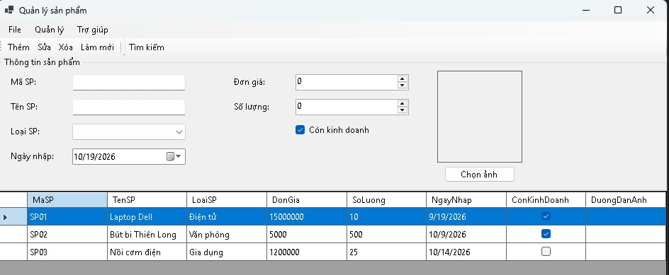
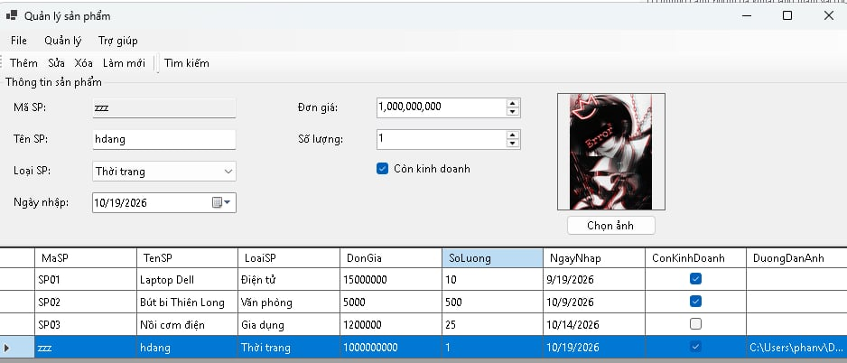
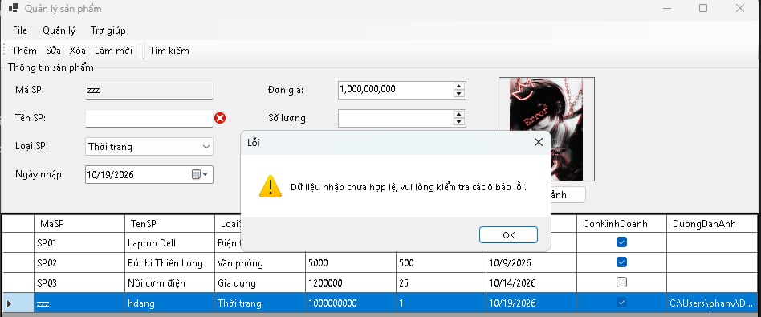
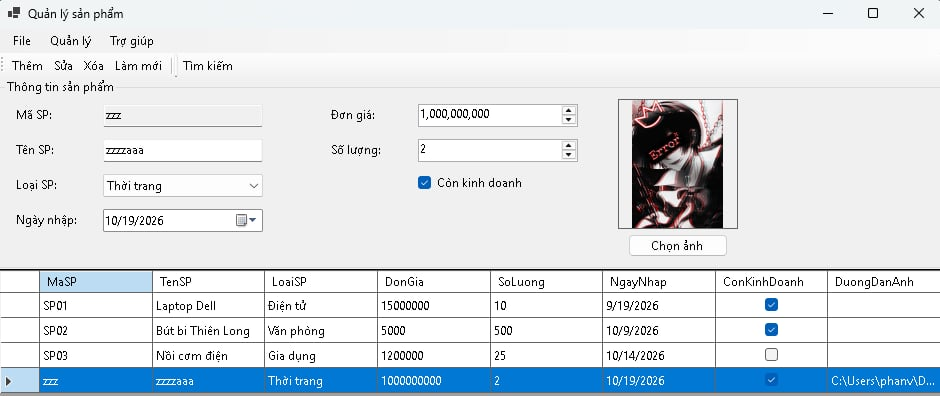
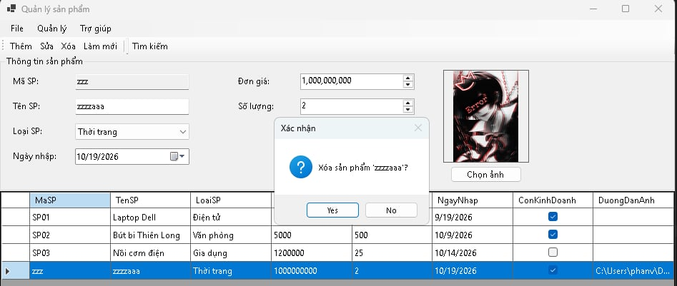
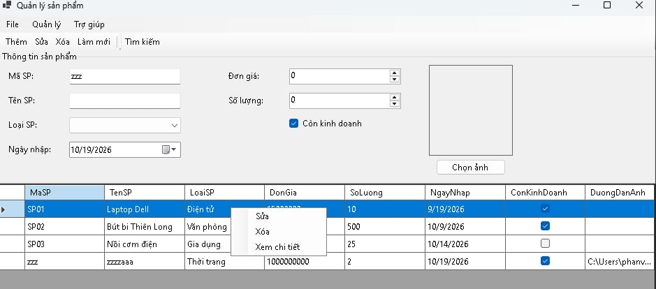
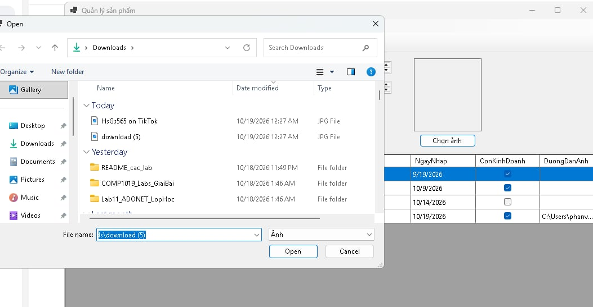

# COMP1019 – Lab 06: Windows Forms nâng cao và DataGridView (ProductManager)

Ứng dụng **quản lý sản phẩm** viết bằng **C# WinForms (.NET 8)**, dữ liệu lưu trong bộ nhớ.
Môn **COMP1019 – Lập trình trên Windows**, Buổi 6.

- Sinh viên: Nguyễn Hải Đăng
- MSSV: 51.01.104.019
- Lớp: 51.CNTT.A

## Cách chạy

1. Cài Visual Studio 2022 trở lên (workload **.NET desktop development**) và .NET 8 SDK.
2. Mở file `ProductManager.csproj` bằng Visual Studio.
3. Nhấn **F5** để chạy.

Chạy bằng dòng lệnh: `dotnet run` trong thư mục project.

## Cách sử dụng

1. Nhập thông tin sản phẩm trong khung **Thông tin sản phẩm**, bấm **Thêm** (menu, toolbar hoặc `Ctrl+N`).
2. **Sửa:** chọn một dòng trong lưới, bấm **Sửa** lần 1 để đưa dữ liệu lên form, chỉnh xong bấm **Sửa** lần 2 để lưu.
3. **Xóa:** chọn dòng rồi bấm **Xóa** (hoặc phím `Delete`), xác nhận trong hộp thoại.
4. **Tìm kiếm:** nhập mã hoặc tên (không phân biệt hoa/thường) ở thanh công cụ rồi bấm **Tìm kiếm**.
5. **Làm mới:** xóa nội dung nhập, bỏ lỗi và hiển thị lại toàn bộ danh sách.
6. Chuột phải vào dòng trong lưới để dùng **Sửa / Xóa / Xem chi tiết**.

## Chức năng

- Load Form: tạo danh sách mẫu (3 sản phẩm) và hiển thị lên `DataGridView`.
- Thêm (kiểm tra dữ liệu, không trùng mã), sửa, xóa có xác nhận, tìm kiếm, làm mới.
- Chọn ảnh bằng `OpenFileDialog`, hiển thị trong `PictureBox`.
- `StatusStrip` cập nhật trạng thái thao tác và số lượng sản phẩm sau mỗi thao tác.
- Phím tắt `Ctrl+N` (thêm), `Delete` (xóa); không bị lỗi khi chưa chọn dòng mà bấm Sửa/Xóa.

## Kỹ thuật chính

- Tên control rõ ràng: `txtMaSP`, `txtTenSP`, `cboLoaiSP`, `numDonGia`, `numSoLuong`, `dtpNgayNhap`, `chkConKinhDoanh`, `dgvProducts`, `lblStatus`.
- Class `Product` lưu dữ liệu; `List<Product>` giữ toàn bộ dữ liệu, `BindingList<Product>` + `BindingSource` gắn vào lưới.
- `DataGridView`: `ReadOnly = true`, `SelectionMode = FullRowSelect`, `MultiSelect = false`.
- `ErrorProvider` báo lỗi từng ô: rỗng, trùng mã, đơn giá ≤ 0, số lượng âm, ngày nhập lớn hơn hôm nay; kèm `MessageBox` tổng hợp.
- Tách hàm: `ValidateInput`, `ClearInput`, `LoadProductToForm`, `RefreshGrid`, `UpdateStatus`.
- Có `MenuStrip` (File, Quản lý, Trợ giúp), `ToolStrip`, `StatusStrip`, `ContextMenuStrip`.
- Ảnh đọc qua `FileStream` rồi copy sang `Bitmap` để không khóa file gốc.

## Cấu trúc project

```
ProductManager
|-- Program.cs
|-- Product.cs      # class dữ liệu sản phẩm
|-- FrmProduct.cs   # giao diện và xử lý chức năng
|-- images/         # ảnh chụp màn hình
```

## Ảnh chụp màn hình

**1. Giao diện chính: menu, toolbar, lưới dữ liệu, status bar**



**2. Thêm sản phẩm thành công**



**3. Kiểm tra dữ liệu: ErrorProvider báo lỗi các ô nhập sai**



**4. Sửa sản phẩm (dữ liệu đã được đưa lên form)**



**5. Hộp thoại xác nhận khi xóa**



**6. Menu chuột phải trên lưới (Sửa, Xóa, Xem chi tiết)**



**7. Chọn ảnh sản phẩm bằng OpenFileDialog**


