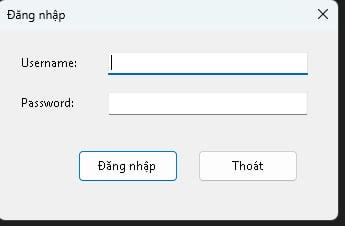
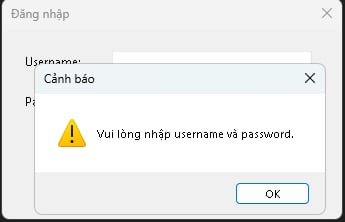
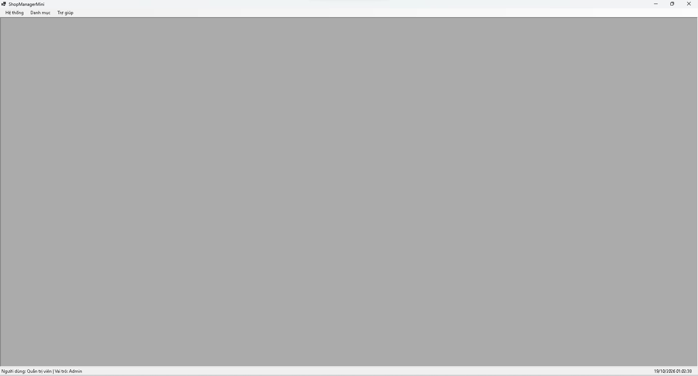
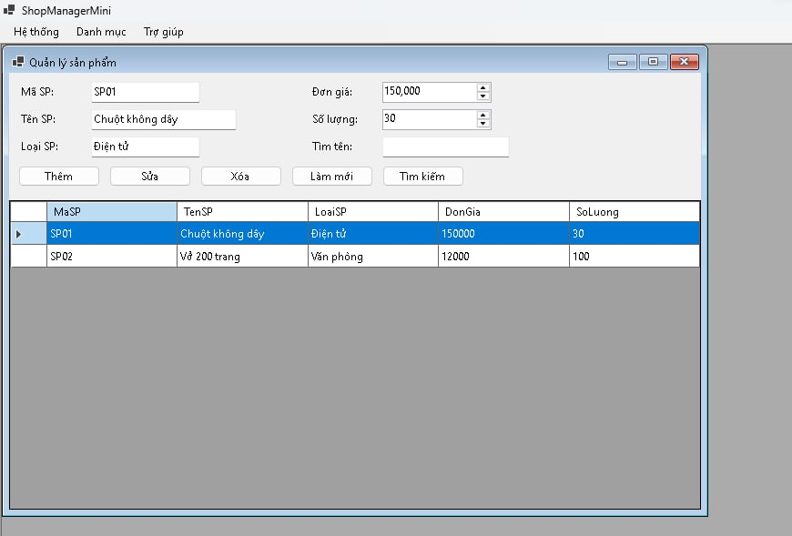
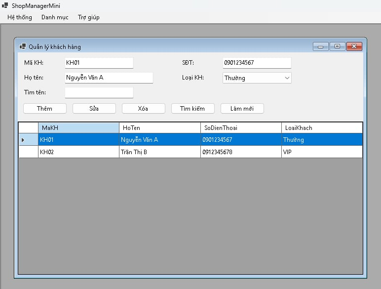
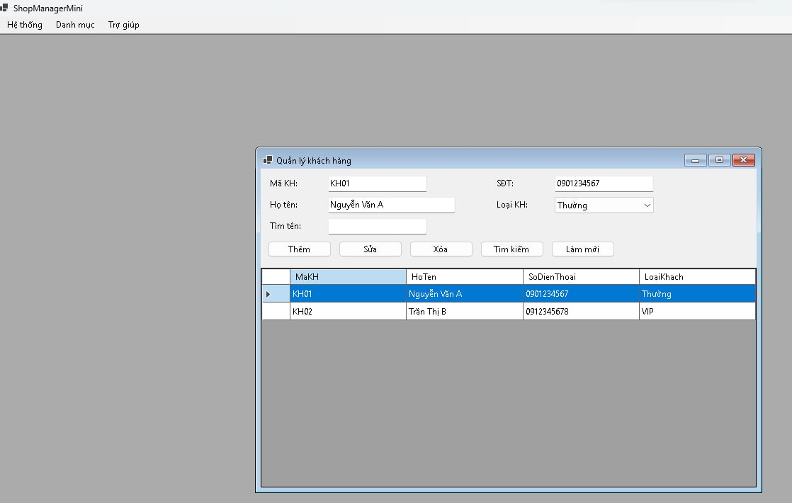
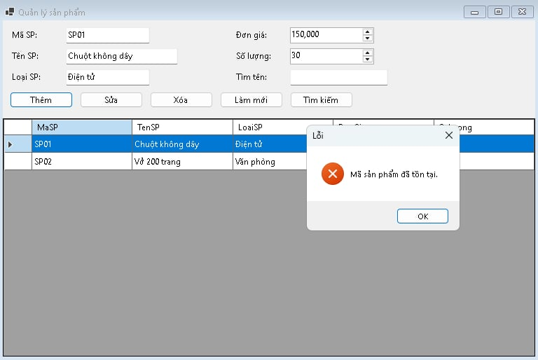
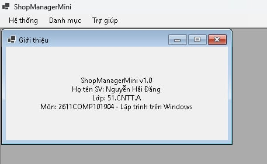
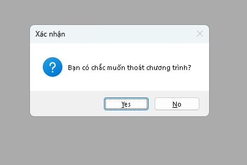

# COMP1019 – Lab 07: SDI, MDI và ứng dụng nhiều Form (ShopManagerMini)

Ứng dụng **quản lý cửa hàng mini** nhiều Form viết bằng **C# WinForms (.NET 8)**, dữ liệu lưu trong bộ nhớ.
Môn **COMP1019 – Lập trình trên Windows**, Buổi 7.

- Sinh viên: Nguyễn Hải Đăng
- MSSV: 51.01.104.019
- Lớp: 51.CNTT.A

## Cách chạy

1. Cài Visual Studio 2022 trở lên (workload **.NET desktop development**) và .NET 8 SDK.
2. Mở file `ShopManagerMini.csproj` bằng Visual Studio.
3. Nhấn **F5** để chạy. Chạy bằng dòng lệnh: `dotnet run`.

**Tài khoản mẫu**

| Username | Password | Họ tên | Vai trò |
|---|---|---|---|
| admin | 123 | Quản trị viên | Admin |
| user | 123 | Nhân viên bán hàng | User |

## Cách sử dụng

1. Đăng nhập ở `FrmLogin`; đăng nhập đúng sẽ mở `FrmMain`.
2. Menu **Danh mục** → *Quản lý sản phẩm* / *Quản lý khách hàng* mở form con bên trong `FrmMain`.
3. Menu **Trợ giúp** → *Giới thiệu* để xem thông tin ứng dụng.
4. Menu **Hệ thống** → *Đăng xuất* / *Thoát* (có xác nhận).

## Chức năng

- **Đăng nhập:** bỏ trống username/password thì cảnh báo; sai thì báo lỗi; đúng thì vào form chính.
- **Form chính MDI:** `IsMdiContainer = true`; `StatusStrip` hiển thị tên người dùng, vai trò và thời gian hiện tại.
- **Không mở trùng form:** bấm menu nhiều lần chỉ kích hoạt form đang mở.
- **Quản lý sản phẩm:** thêm, sửa, xóa (có xác nhận), tìm kiếm, làm mới; không trùng mã, không cho đơn giá hoặc số lượng âm; hiển thị bằng `DataGridView`.
- **Quản lý khách hàng:** thêm, sửa, xóa, tìm kiếm và hiển thị bằng `DataGridView`.
- Khi thoát chương trình hỏi xác nhận bằng `MessageBox`.

## Kỹ thuật chính

- `FrmLogin` mở bằng `ShowDialog()`; user đăng nhập truyền sang `FrmMain` qua property `LoggedInUser` và constructor `FrmMain(User)`.
- Hàm generic `OpenChild<T>()`: dùng `MdiChildren.OfType<T>()` để kiểm tra form đã mở chưa, nếu có thì `Activate()`.
- Dữ liệu lưu trong `BindingList<T>` gắn vào `DataGridView`.
- Tách class Model (`User`, `Product`, `Customer`) khỏi Form.
- `Timer` cập nhật thời gian trên `StatusStrip`.

## Cấu trúc project

```
ShopManagerMini
|-- Models
|   |-- User.cs
|   |-- Product.cs
|   |-- Customer.cs
|-- Forms
|   |-- FrmLogin.cs
|   |-- FrmMain.cs
|   |-- FrmProduct.cs
|   |-- FrmCustomer.cs
|   |-- FrmAbout.cs
|-- Program.cs
|-- images/           # ảnh chụp màn hình
```

## Trả lời câu hỏi nộp kèm

1. **SDI và MDI khác nhau thế nào?** SDI: mỗi cửa sổ là một form độc lập, mỗi lần làm việc với một tài liệu. MDI: một form cha (`IsMdiContainer = true`) chứa nhiều form con bên trong, dùng chung menu và status bar.
2. **Vì sao Form đăng nhập nên dùng `ShowDialog()`?** Vì đây là form modal: chặn thao tác với form khác cho đến khi đóng, và trả về `DialogResult` để biết đăng nhập thành công hay không rồi mới mở form chính.
3. **Dữ liệu user truyền từ `FrmLogin` sang `FrmMain` bằng cách nào?** `FrmLogin` có property `LoggedInUser`; sau khi `ShowDialog()` trả về OK, `Program` lấy user này và truyền vào constructor `new FrmMain(user)`.
4. **Bấm menu nhiều lần, làm sao không mở trùng Form?** Kiểm tra `MdiChildren.OfType<T>().FirstOrDefault()`; nếu đã có thì `Activate()`, chưa có mới tạo form mới với `MdiParent = this`.
5. **Khi nào dùng constructor, khi nào dùng property?** Constructor: dữ liệu bắt buộc, truyền một lần lúc tạo form (vd `FrmMain(User)`). Property: dữ liệu tùy chọn, hoặc cần lấy kết quả/đổi giá trị sau khi form đã tạo (vd `LoggedInUser`).

## Ảnh chụp màn hình

**1. Form đăng nhập**



**2. Đăng nhập sai hoặc bỏ trống: thông báo lỗi**



**3. Form chính sau khi đăng nhập (StatusStrip hiển thị tên và vai trò)**



**4. Form quản lý sản phẩm mở bên trong FrmMain**



**5. Form quản lý khách hàng**



**6. Mở nhiều form cùng lúc: bấm menu lại không tạo form trùng**



**7. Thêm sản phẩm trùng mã hoặc nhập giá âm: thông báo lỗi**



**8. Form Giới thiệu**



**9. Hộp thoại xác nhận khi thoát**

