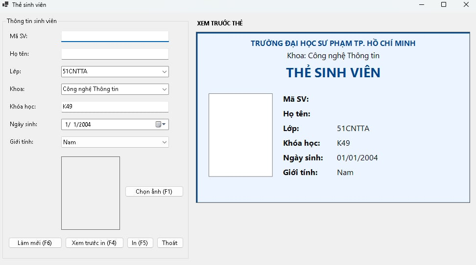
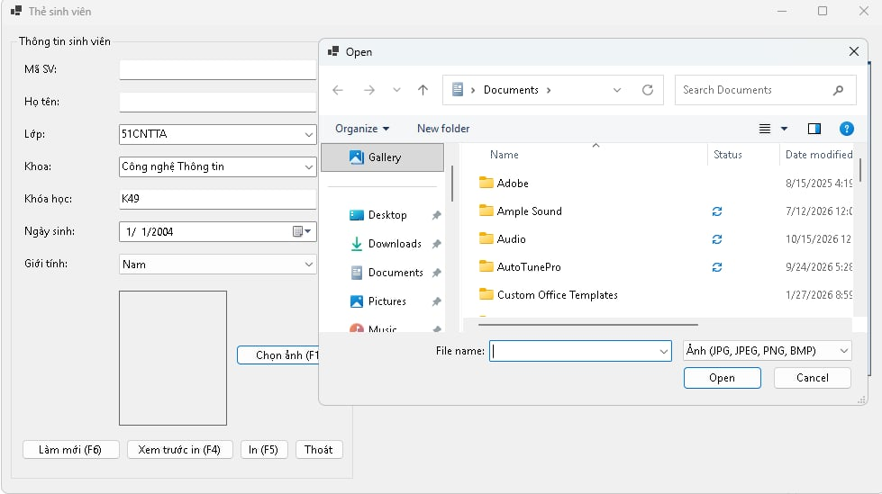
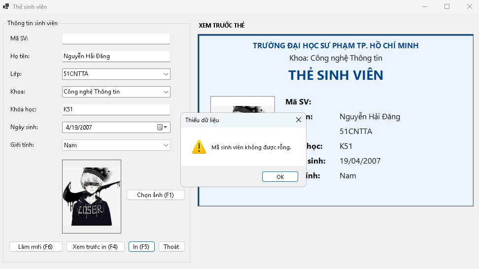
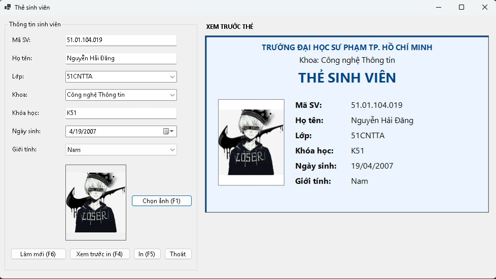
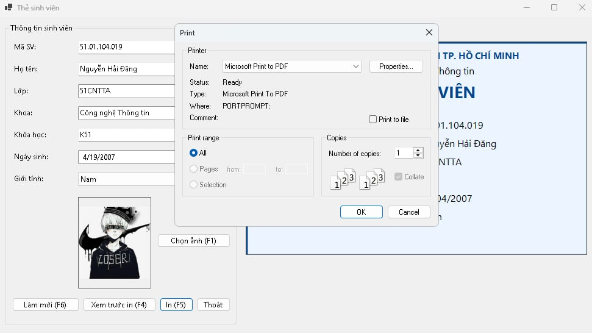
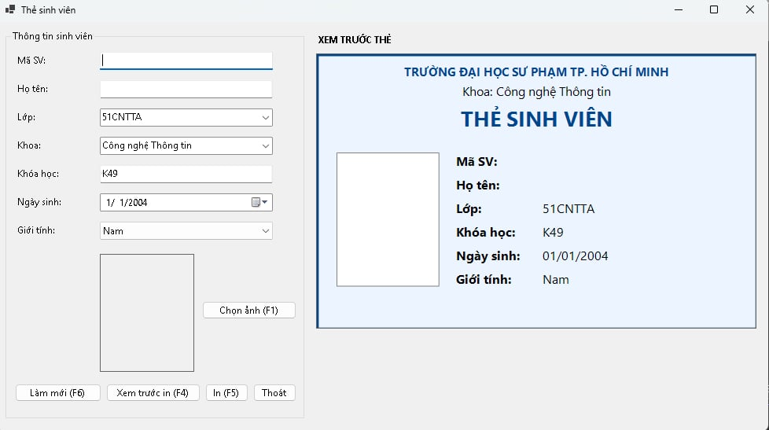

# COMP1019 – Lab 09: Thiết kế và in thẻ sinh viên bằng WinForms

Ứng dụng nhập thông tin sinh viên, xem trước và **in thẻ sinh viên**, viết bằng **C# WinForms (.NET 8)** và **GDI+**.
Môn **COMP1019 – Lập trình trên Windows**, Buổi 9.

- Sinh viên: Nguyễn Hải Đăng
- MSSV: 51.01.104.019
- Lớp: 51.CNTT.A

## Cách chạy

1. Cài Visual Studio 2022 trở lên (workload **.NET desktop development**) và .NET 8 SDK.
2. Mở file `StudentCard.csproj` bằng Visual Studio.
3. Nhấn **F5** để chạy. Chạy bằng dòng lệnh: `dotnet run`.
4. Muốn thử in mà không có máy in: chọn **Microsoft Print to PDF** trong hộp thoại in.

## Cách sử dụng

1. Nhập mã sinh viên, họ tên, lớp, khoa, khóa học, ngày sinh, giới tính; panel bên phải cập nhật thẻ ngay khi nhập.
2. Bấm **Chọn ảnh** (`F1`) để chọn ảnh đại diện.
3. Bấm **Xem trước in** (`F4`) hoặc **In** (`F5`); **Làm mới** (`F6`) để xóa dữ liệu.

## Chức năng

| Mã | Chức năng | Mô tả |
|---|---|---|
| F1 | Chọn ảnh | `OpenFileDialog` lọc JPG, JPEG, PNG, BMP; ảnh hiển thị chế độ Zoom |
| F2 | Preview thẻ | Panel được vẽ lại bằng GDI+ mỗi khi dữ liệu đổi |
| F3 | Validation | Không preview/in nếu thiếu mã sinh viên, họ tên hoặc ảnh |
| F4 | Print Preview | Mở `PrintPreviewDialog` |
| F5 | Print | Mở `PrintDialog` và in qua `PrintDocument` |
| F6 | Làm mới | Xóa dữ liệu nhập, xóa ảnh, đưa form về trạng thái ban đầu |

## Kỹ thuật chính

- Hàm `DrawCard(Graphics, Rectangle)` dùng chung cho Panel preview và máy in, tự co giãn theo kích thước vùng vẽ.
- Ảnh vẽ giữ đúng tỉ lệ (tính hệ số `ratio`), không bị méo khi hiển thị và khi in.
- Ảnh được đọc qua `FileStream` rồi copy sang `Bitmap` nên không khóa file ảnh cũ; có `try/catch` khi mở ảnh lỗi.
- Các đối tượng `Font`, `Brush`, `Pen` tự tạo đều giải phóng bằng `using`.
- `PrintDocument` đặt khổ ngang; sự kiện `PrintPage` vẽ thẻ có khung, tiêu đề, ảnh bên trái, thông tin bên phải.

## Cấu trúc project

```
StudentCard
|-- Program.cs
|-- FrmStudentCard.cs   # giao diện, vẽ thẻ, in ấn
|-- images/             # ảnh chụp màn hình
```

## Test case tự kiểm thử

| # | Thao tác | Kết quả mong đợi | Kết quả |
|---|---|---|---|
| 1 | Bấm Xem trước in khi để trống mã SV | Báo "Mã sinh viên không được rỗng" | Đạt |
| 2 | Nhập mã, để trống họ tên, bấm In | Báo "Họ tên không được rỗng", không in | Đạt |
| 3 | Nhập mã và tên, chưa chọn ảnh, Xem trước in | Báo "Vui lòng chọn ảnh đại diện" | Đạt |
| 4 | Mở OpenFileDialog | Chỉ hiện file JPG, JPEG, PNG, BMP | Đạt |
| 5 | Chọn ảnh chân dung (dọc) | Ảnh không bị méo ở PictureBox và Panel | Đạt |
| 6 | Gõ họ tên, đổi lớp, đổi khoa | Panel preview cập nhật ngay | Đạt |
| 7 | Nhập đủ dữ liệu, Xem trước in | PrintPreviewDialog hiện thẻ đầy đủ | Đạt |
| 8 | Đổi sang ảnh khác rồi xóa file ảnh cũ trên đĩa | Xóa được file, chương trình không báo lỗi | Đạt |
| 9 | Bấm Làm mới | Dữ liệu và ảnh được xóa, form về trạng thái đầu | Đạt |

> Cột "Kết quả": bạn tự chạy thử và sửa lại cho đúng thực tế.

## Ảnh chụp màn hình

**1. Form chính: vùng nhập liệu và preview thẻ**



**2. Chọn ảnh đại diện bằng OpenFileDialog**



**3. Thiếu dữ liệu bắt buộc: thông báo lỗi**



**4. Print Preview: thẻ sinh viên khi xem trước in**



**5. Hộp thoại PrintDialog chọn máy in**



**6. Sau khi bấm Làm mới**


